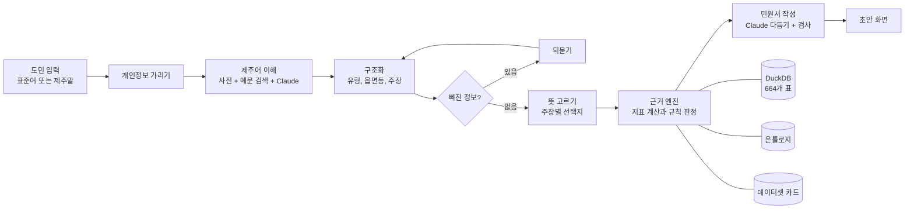

# 민원똑딱

제주말로 생활 불편을 이야기하면 제주 공공데이터에서 근거를 찾아 민원서 초안까지 만들어 주는 AI Agent.

- 「제주 AI·빅데이터 활용 AI Agent 개발 챌린지」 출품작
- IT에 익숙하지 않은 도민이 제주빅데이터센터 PC에서 혼자 실행해 쓸 수 있게 만듦

- 팀: 아꼬비둘
- 실행 환경: Windows 10 이상, Python 3.11 (센터 PC 기준 i7-8700, RAM 32GB, GPU 불필요)
- 사용 모델: Claude Haiku 5.5 (`claude-haiku-5-5`), 키가 없으면 규칙만으로 동작
- 문서: [실행 매뉴얼](실행_매뉴얼.md) / [데이터 활용 명세](데이터_활용_명세.md) / [아키텍처](docs/architecture.md) / [개발 가이드](docs/development.md)

## 목차

- [개발 배경](#개발-배경)
- [사용 흐름](#사용-흐름)
- [빠르게 시작하기](#빠르게-시작하기)
- [동작 방식](#동작-방식)
- [Agent 구성](#agent-구성)
- [사용 모델과 AI 활용 범위](#사용-모델과-ai-활용-범위)
- [데이터](#데이터)
- [검증](#검증)
- [알려진 한계](#알려진-한계)
- [저장소 구조](#저장소-구조)
- [보안과 개인정보](#보안과-개인정보)
- [외부 서비스와 오픈소스](#외부-서비스와-오픈소스)
- [소유권](#소유권)

## 개발 배경

제주 도민에게 민원은 두 번 어려움.

- 국민신문고 같은 창구는 표준어로 정리된 글을 요구함
- 담당 부서는 "얼마나 불편한지"를 보여 줄 근거가 있어야 움직이기 쉬움
- 그 근거가 되는 공공데이터는 찾기도 읽기도 어려움

민원똑딱은 이 둘을 한 번에 지원함.

1. 평소 말투나 제주말로 쓴 불편을 알아듣고, 모르는 부분만 되물음
2. 말한 내용을 데이터로 확인할 수 있는 주장으로 나눠 제주데이터허브 자료로 계산함
3. 확인된 근거만 골라 넣은 표준어 민원서 초안을 만듦. 접수는 본인이 국민신문고 등에서 직접 함

## 사용 흐름

화면은 브라우저에서 열리고, 세 단계로 이어짐.

| 단계 | 화면에서 하는 일 |
| --- | --- |
| 1. 불편 쓰기 | 불편한 점을 평소 말투로 작성. 지역(읍면동 여러 곳, 제주 전체)과 주제는 선택하거나 건너뛰기 가능 |
| 2. 내용 확인 | 뜻을 모르는 제주말이나 빠진 지역만 되묻고, 말씀이 어떤 뜻인지 선택(최대 3개). 마지막으로 이해한 내용을 보여 주고 맞는지 확인 |
| 3. 민원서 만들기 | 찾은 근거 카드 중 넣을 것을 고르면 초안 생성. 고쳐 쓰기, 처음 초안으로 되돌리기, 제목과 내용 복사, 인쇄, 텍스트 파일 받기 가능 |

예를 들어 "우리 동네 버스가 확 줄어부난 할망덜 병원 가기가 막 힘들어마씸"에 구좌읍을 고르면, 엔진은 아래처럼 주장마다 근거를 계산함(스냅샷 2026-11-17 기준 실제 결과).

| 주장 | 지표 | 값 | 비교 | 판정 |
| --- | --- | --- | --- | --- |
| 버스 감소 | 버스 정류소 이용 인원 증감률 (최근 12개월 대 직전 12개월) | -11.32% | 읍면 11곳 중 불리한 순 2위 | 일부만 확인됨 (운행 횟수가 아닌 이용 인원으로 본 대리 지표) |
| 노인의 병원 접근 어려움 | 65세 이상 1천 명당 의원 수 | 4.42곳 | 읍면 12곳 중 불리한 순 8위 | 일부만 확인됨 |

- 버스 운행 횟수와 배차 간격은 허브에 과거 값이 없어 "자료로 확인 불가"와 빈칸 사유로 따로 안내함
- 근거가 없다고 숫자를 만들어 넣지 않음

## 빠르게 시작하기

### 센터 PC에서 (제출 ZIP)

제출 ZIP에는 근거 DB 스냅샷과 제주어 사전처럼 GitHub에 올리지 않는 실행 자료가 함께 들어 있음.

1. ZIP을 `C:\jeju\`에 풂
2. `설치.bat`을 실행함. 가상환경을 만들고 패키지를 설치한 뒤 스냅샷으로 근거 DB를 만듦
3. Claude를 쓰려면 `evidence_engine\.env`에 평가용 키를 넣고, `실행.bat`의 `ALLOW_PAID_CALLS=0`을 `1`로 바꿈
4. `실행.bat`을 실행하면 브라우저에 화면이 뜸 (`http://localhost:8501`)

자세한 절차와 문제 해결은 [실행 매뉴얼](실행_매뉴얼.md) 참고.

### 소스에서 (개발자)

```bash
python3.11 -m venv .venv
source .venv/bin/activate            # Windows: .venv\Scripts\activate
pip install -r requirements.txt
streamlit run complaint_draft/app.py
```

- 저장소만 받으면 근거 DB가 없어 엔진이 형식 확인용(mock) 결과를 냄
- DB를 직접 만드는 방법은 [데이터 파이프라인](docs/data-pipeline.md) 참고

## 동작 방식



설계 원칙은 세 가지.

- 숫자는 도구만 만듦
  - 근거의 값은 등록된 지표 함수와 읽기 전용 SQL에서만 나옴
  - LLM은 문장을 이해하고 다듬는 데만 씀
  - 민원서에 들어간 숫자도 사용자 글, 고른 주장, 지역 이름에 있는 것만 허용함
- 판정은 규칙이 내림
  - "자료로 확인됨 / 일부만 확인됨 / 자료와 다름 / 자료로 확인 불가" 중 하나
  - 반대 근거와 빈칸도 숨기지 않음
- 실패해도 멈추지 않음
  - Claude가 없으면 규칙 구조화와 기본 문장 틀로, 사전이 없으면 표준어 변환 없이, DB가 없으면 형식 확인 모드로 이어 감
  - 어떤 경로로 만들었는지는 화면에 안내함

모듈 사이 계약(JSON Schema), 판정 규칙, 실패 처리 표는 [아키텍처 문서](docs/architecture.md)에 정리함.

## Agent 구성

| 역할 | 하는 일 | 쓰는 도구 | 판단 주체 |
| --- | --- | --- | --- |
| 이해 | 제주말을 표준어로 바꾸고 뜻을 모르는 낱말 골라내기 | 방언 사전(59,473 낱말), TF-IDF 예문 검색, Claude | Claude가 바꾸고, 코드가 사전 근거를 검사 |
| 구조화 | 민원 유형, 읍면동, 주장, 바라는 점 뽑기 | Claude Structured Outputs, 43개 읍면동 목록, JSON Schema | Claude가 채우고, 코드가 목록과 스키마로 검사 |
| 되묻기 | 빠지거나 불확실한 것만 질문하기 | 상태 검사 규칙 | 규칙 |
| 뜻 고르기 | 주장마다 계산 가능한 뜻과 자료 없는 뜻 보여 주기 | 지표 등록부(판정 17개, 맥락 3개) | 사용자가 고름 |
| 근거 찾기 | 개념 확장, 카탈로그 검색, 지표 계산, 비교, 판정하기 | 온톨로지(jeju.ttl), BM25 카드 검색, DuckDB 읽기 전용 SQL, 차트 | 규칙 |
| 작성 | 제목, 내용, 요청 사항을 합니다체로 다듬기 | Claude, 숫자와 길이 검사, 개인정보 재검사 | Claude가 쓰고, 코드가 통과 여부 결정 |

- 사람이 결정하는 지점은 네 곳: 되묻기 답, 뜻 고르기, 최종 확인, 넣을 근거 고르기
- Agent는 민원을 대신 접수하지 않음
- 사용자가 확인하지 않은 내용은 초안에 넣지 않음

## 사용 모델과 AI 활용 범위

### 실행 중에 쓰는 모델

| 모델 | 쓰는 곳 | 프롬프트 위치 | 없거나 실패하면 |
| --- | --- | --- | --- |
| Claude Haiku 5.5 (`claude-haiku-5-5`) | 제주어를 표준어로 바꾸기 | `dialect_normalizer/normalize.py` (`RULES_RAG`) | 표준어 변환 없이 진행 |
| 같은 모델 | 구조화 (유형, 읍면동, 주장) | `dialect_normalizer/structure.py` (`RULES`) | 규칙 구조화 |
| 같은 모델 | 민원서 제목, 내용, 요청 사항 다듬기 | `complaint_draft/writer.py` (`SYSTEM`) | 기본 문장 틀 |

- 모든 Claude 호출은 `dialect_normalizer/llm.py` 한 곳을 지나감. 응답은 최대 60초 기다리고 한 번만 다시 시도함
- `ALLOW_PAID_CALLS=1`을 사람이 직접 설정하지 않으면 호출 자체를 막음. 예시 설정 파일을 복사하는 것만으로는 켜지지 않음
- Claude에는 개인정보를 가린 문장만 보냄
- 근거 엔진의 LLM 설정(`evidence_engine/config.yaml`의 `llm`)은 기본이 `mock`이라 실행 중에 호출하지 않음. 교차 확인 지표는 지표마다 정해 둔 목록으로 붙임

### 개발 과정에서 쓴 AI

- 코드 작성과 검토에 Claude Code(Anthropic) 사용
- 개발 과정 보조에 ChatGPT(OpenAI) 사용
- 온톨로지와 개념 태그는 LLM 없이 규칙으로 만듦. LLM 보강 코드(`config.yaml`의 `dev_llm`, Claude Sonnet 5.5)는 있지만 이번 제출본에는 쓰지 않음
- 제주어 변환 평가(`dialect_normalizer/evaluate.py`)에서 Claude Haiku 5.5 호출

## 데이터

| 구분 | 내용 |
| --- | --- |
| 필수 데이터 | 제주데이터허브 파일 24종(표 29개), Open API 6종 |
| 허브 원본 | 공공데이터포털 파일 18종 (허브에 등록된 데이터의 원본 파일) |
| 외부 공개 데이터 | 행정안전부 주민등록 인구(파일, API), 국가데이터처 법정동 연계정보, 행정동 경계(SGIS 가공본) |
| 범용 틀용 | 허브의 10MB 이하 표 511종을 미리 받아 두고, 등록 지표가 없는 주장에 참고용 집계로 사용 |
| 제주어 | AI Hub 한국어 방언 발화(제주도), 중노년층 방언 데이터로 만든 사전과 예문 색인 |

- 모든 표는 읍면동 코드(행정동 8자리)와 기간을 공통 키로 맞춰 DuckDB 하나에 적재함
- 지표는 이 키로 여러 데이터를 결합해 인구 대비 개수, 증감률, 같은 유형 지역(읍면끼리, 동끼리) 사이 순위를 계산함
- 데이터마다 제공기관, 출처 주소, 기준일, 이용조건, 쓰는 지표는 [데이터 활용 명세](데이터_활용_명세.md)에 정리됨
- 이 문서는 `python evidence_engine/data/data_spec.py`로 근거 DB와 지표 등록부에서 자동 생성하므로 엔진이 실제로 쓰는 자료와 어긋나지 않음
- 같은 결과를 다시 얻을 수 있도록 근거 DB 전체를 스냅샷(`evidence_engine/data/snapshot/2026-11-17/`, parquet 664개, 약 63MB)으로 고정함
- 설치할 때 이 스냅샷으로 DB를 다시 만들고, 해시와 행 수를 대조함

## 검증

| 항목 | 방법 | 결과 |
| --- | --- | --- |
| 자동 테스트 | pytest 523개, 네트워크와 유료 호출 없이 실행 | 전부 통과 |
| CI | GitHub Actions, Ubuntu와 Windows에서 전체 설치와 일부가 빠진 설치, CP949 출력, `설치.bat` 실제 실행 | 통과 |
| 이해와 근거 | 정답 세트 32건(`complaint_agent/eval/gold.yaml`), 규칙 구조화 기준 | 읍면동 32/32, 주제 32/32, 정답 뜻이 선택지에 있음 31/31, 뜻을 고른 뒤 정답 지표로 계산 35/35 |
| 제주어 변환 | AI Hub 평가셋 일상대화, 어르신 각 20문장 표본, 어절 단위 ERR | 일상대화 45.1, 어르신 72.8 (표본이 작아 참고용) |

```bash
python -m pytest -q                              # 전체 테스트
python -m complaint_agent.eval.run_eval          # 정답 세트 평가 (유료 호출 없이)
```

- 평가 결과 원문 위치: `complaint_agent/eval/results/`, `dialect_normalizer/results/`
- 지표의 계산식과 근거 논문은 [제주어 모듈 문서](dialect_normalizer/README.md#평가-지표) 참고

## 알려진 한계

- 데이터 범위: 허브 1,259종 중 559종을 받았지만 민원에 바로 쓸 수 있는 시설 목록은 많지 않음. 가로등과 보안등, 무더위쉼터, 버스 배차, 주민센터는 허브에 자료가 없어 "자료로 확인 불가"로 안내함
- 오래된 자료: 원자료 기준일이 2년을 넘는 표가 있어 근거 카드에 "오래된 자료"로 표시함
- 대리 지표: 버스 운행 횟수 대신 정류소 이용 인원처럼 비슷한 다른 값으로 본 근거는 "일부만 확인됨"으로 낮춤
- 규칙 구조화: Claude 없이 동작할 때는 주장을 문장 하나로 묶으므로 뜻 고르기가 더 중요해짐
- 제주어 사전: 일상대화 자료로 만든 사전이라 배수로, 가로등 같은 민원 어휘가 적을 수 있음

## 저장소 구조

```
.
├── 설치.bat, 실행.bat          # 센터 PC 설치와 실행
├── 실행_매뉴얼.md              # 사용자 매뉴얼
├── 데이터_활용_명세.md          # 자동 생성되는 데이터 명세
├── make_submission.py          # 제출 ZIP 만들기
├── requirements.txt            # 세 모듈 의존성을 한 번에 설치
├── .streamlit/config.toml      # 운영용 화면 설정 (이 PC에서만 접속, 오류 상세 숨김)
├── complaint_draft/            # 화면, 대화 흐름, 민원서 작성
├── complaint_agent/            # 이해 모듈과 근거 엔진 연결, 터미널 실행, 정답 세트 평가
├── dialect_normalizer/         # 제주어 이해, 구조화, 되묻기 질문, Claude 호출 통로
├── evidence_engine/            # 근거 엔진 (데이터 적재, 검색, 지표, 판정, 근거 패키지)
└── docs/                       # 아키텍처, 데이터 파이프라인, 개발 가이드
```

모듈별 설명은 각 폴더의 README 참고.

- [complaint_draft](complaint_draft/README.md): 화면과 민원서 작성
- [dialect_normalizer](dialect_normalizer/README.md): 제주어 이해와 구조화
- [evidence_engine](evidence_engine/README.md): 근거 엔진

## 보안과 개인정보

- 이름, 전화번호, 주민번호, 이메일, 상세주소는 Claude에 보내기 전에 `○○`로 가림. 되묻기 답과 직접 고친 글도 다시 가림
- 엔진은 원문(`raw_text`)을 받자마자 버리고, 로그와 빈칸 기록에 민원 문장을 남기지 않음
- 화면은 실행한 PC에서만 열림(`server.address = "localhost"`). 같은 네트워크의 다른 컴퓨터가 평가용 키를 쓰지 못하게 하기 위한 설정
- 오류가 나면 화면에는 짧은 안내만 보이고, 자세한 내용은 실행 창에만 남음
- 사용자 글은 화면에 넣을 때 마크다운과 HTML로 해석되지 않게 처리함
- API 키, `.env`, 원자료, 대회 제공 목록 파일은 저장소에 올리지 않음. 원자료와 가공 자료는 대회 안내에 따라 제출 ZIP에만 넣음

## 외부 서비스와 오픈소스

| 서비스 | 쓰는 곳 | 필요한 때 |
| --- | --- | --- |
| Claude API (Anthropic) | 제주어 이해, 구조화, 민원서 다듬기 | 실행 중 (없으면 규칙으로 동작) |
| Google Fonts | 화면 글꼴 Jua, Noto Sans KR | 실행 중 (없으면 기본 글꼴) |
| PyPI | 패키지 설치 | 설치할 때 |
| 제주데이터허브, 공공데이터포털 API | 데이터 수집 | 데이터를 새로 받을 때만 (실행에는 불필요) |

- 사용한 오픈소스 패키지와 버전, 라이선스는 [데이터 활용 명세의 오픈소스 목록](데이터_활용_명세.md#5-오픈소스) 참고
- 패키지 버전은 `requirements.txt`에 모두 고정함

## 소유권

- 대회 규칙에 따라 이 결과물의 소유권은 제주빅데이터센터에 있음
- 데이터의 저작권과 이용조건은 각 제공기관을 따름
