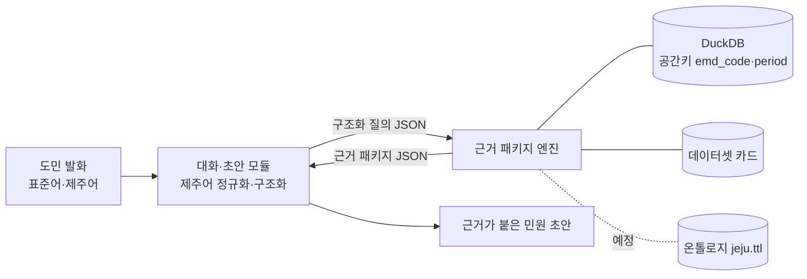

# 민원 말해봅서 · 제주 민원 근거·초안 AI Agent

도민이 표준어나 제주어로 생활 불편을 말하면, 제주데이터허브·제주빅데이터센터·공공데이터로 주장을 확인하고 근거가 붙은 민원 초안을 만들어 주는 AI Agent입니다.

「제주 AI·빅데이터 활용 AI Agent 개발 챌린지」 출품작이며, IT 비전문가 도민이 제주빅데이터센터 PC에서 직접 실행하는 것을 목표로 합니다.

## 목차

- [현재 상태](#현재-상태)
- [아키텍처](#아키텍처)
- [저장소 구조](#저장소-구조)
- [시작하기](#시작하기)
- [데이터 준비](#데이터-준비)
- [실행](#실행)
- [테스트](#테스트)
- [모듈 간 인터페이스](#모듈-간-인터페이스)
- [협업 규칙](#협업-규칙)
- [보안·개인정보](#보안개인정보)
- [데이터 출처와 이용조건](#데이터-출처와-이용조건)
- [담당](#담당)

## 현재 상태

이 README에는 실제로 동작하는 기능만 적습니다. 예정 기능은 "예정"으로 표시합니다.

| 영역 | 상태 |
| --- | --- |
| 입출력 계약(JSON Schema)과 검증 | 동작 |
| 근거 패키지 엔진 CLI | 동작 (mock 응답만 반환, 실제 탐색·계산은 예정) |
| 데이터 수집·DuckDB 적재 | 동작 (52개 테이블, 데이터허브 등록 데이터명 기준 47종) |
| 읍면동 공간키 부여 | 동작 (이름·법정동 연계표·좌표 공간조인) |
| 데이터셋 카드 | 동작 (1,330건, 개념 태그는 예정) |
| 카탈로그 검색, 지표 계산, 판정 | 예정 |
| 온톨로지(RIGOR) 기반 개념 확장 | 예정 |
| 제주어 이해·민원 초안·UI | 대화·초안 담당 모듈에서 개발 중 (이 브랜치에는 없음) |

## 아키텍처

두 모듈이 JSON 두 개(구조화 질의, 근거 패키지)로만 연결됩니다. 각자 상대 쪽을 mock으로 대신해 따로 개발하고 마지막에 붙입니다.



근거 패키지 엔진의 처리 원칙은 다음과 같습니다.

- **숫자는 도구만 만듭니다.** 패키지의 수치는 지표 함수·읽기 전용 SQL 결과에서만 나옵니다. LLM은 가설 문장·설명에만 씁니다.
- **판정은 규칙이 내립니다.** `supported` / `partial` / `contradicted` / `unverifiable` 중 하나이며, 반대 근거와 빈칸도 숨기지 않습니다.
- **`use_ontology` 스위치**: 끄면 온톨로지 단계를 건너뛰고 카탈로그 검색만으로 같은 형식의 결과를 냅니다.

## 저장소 구조

```
.
├── README.md
├── .gitignore
└── evidence_engine/            # 근거 패키지 엔진
    ├── run_engine.py           # CLI 진입점
    ├── config.yaml             # 경로·임계값·점수 가중치·LLM 설정 (비밀값 없음)
    ├── .env.example            # 환경 변수 이름만
    ├── requirements.txt        # 버전 고정 의존성
    ├── contracts/              # query.schema.json, evidence.schema.json
    ├── data/
    │   ├── ingest/             # 수집기, datasets.yaml(수집·적재 대상 정의)
    │   ├── spatial/            # 행정동 코드표, 이름·법정동 매칭, 좌표 공간조인
    │   ├── build_db.py         # raw → DuckDB 적재
    │   └── snapshot/           # 재현용 스냅샷 (예정)
    ├── catalog/                # 데이터셋 카드 생성 (검색 인덱스·개념 태그는 예정)
    ├── ontology/               # RIGOR 입력 export·경로 탐색 (예정)
    ├── retrieval/              # 개념 확장·카탈로그 검색·병합 (예정)
    ├── indicators/             # 지표 정의·함수 (예정)
    ├── compute/                # 읽기 전용 SQL·차트 (예정)
    ├── verdict/                # 판정 규칙 (예정)
    ├── package/                # 근거 패키지 조립·계약 검증
    ├── agent/                  # LLM 클라이언트(mock 기본, 유료 호출 차단)
    └── tests/                  # pytest, fixtures(구조화 질의 10개)
```

"예정" 모듈은 골격만 있으며 호출하면 `NotImplementedError`를 냅니다.

## 시작하기

### 요구 사항

- Python 3.11
- Windows 10 이상 또는 macOS. 센터 PC 기준 사양은 Intel i7-8700, RAM 32GB, Windows입니다.
- 인터넷 연결 (데이터 수집 단계에만 필요)

### 설치

Windows (PowerShell):

```powershell
py -3.11 -m venv .venv
.venv\Scripts\Activate.ps1
pip install -r evidence_engine\requirements.txt
```

macOS:

```bash
python3.11 -m venv .venv
source .venv/bin/activate
pip install -r evidence_engine/requirements.txt
```

### 환경 변수

`evidence_engine/.env.example`을 `evidence_engine/.env`로 복사한 뒤 값을 채웁니다. `.env`는 커밋하지 않습니다.

| 이름 | 용도 | 발급 |
| --- | --- | --- |
| `JEJUDATAHUB_PROJECT_KEY` | 제주데이터허브 Open API 호출 | 데이터허브 회원가입 → 프로젝트 생성 → 키 발급. 쓸 API마다 데이터 상세 화면에서 "프로젝트 담기"를 해야 합니다(안 하면 HTTP 403). |
| `ANTHROPIC_API_KEY`, `OPENROUTER_API_KEY` | LLM 호출 (예정) | 공급자 확정 후 안내 |
| `ALLOW_PAID_CALLS` | 유료 LLM 호출 허용 스위치 | 사람이 직접 `1`로 설정할 때만 실제 호출이 나갑니다. |

## 데이터 준비

원본 데이터는 저장소에 넣지 않습니다. 아래 순서로 `evidence_engine/data/ingest/raw/` 아래에 모은 뒤 DuckDB를 만듭니다. 명령은 `evidence_engine/` 폴더에서 실행합니다.

1. **데이터허브 목록**: `python data/ingest/fetch_hub_catalog.py`
2. **데이터허브 FILE**: `python data/ingest/hub_files.py` (약 624MB 파일까지 받으려면 `--large`)
3. **데이터허브 API**: `python data/ingest/hub_api.py` (`.env`의 키 필요, API별 하루 1,000건 쿼터)
4. **공공데이터포털 파일**: `datasets.yaml`의 `portal_files`에 적힌 17개 파일을 공공데이터포털에서 내려받아 `raw/datagokr/`에 파일명 그대로 넣습니다.
5. **법정동 연계표**: [국가데이터처_법정동 연계정보](https://www.data.go.kr/data/15136368/fileData.do) CSV를 `raw/emd_link/`에 넣습니다.
6. **행정동 경계**: [vuski/admdongkor](https://github.com/vuski/admdongkor)의 `HangJeongDong_ver<날짜>.geojson`을 `raw/boundary/`에 넣습니다.
7. **빅데이터센터 데이터 명세서**: 센터에서 받은 명세서 xlsx를 `raw/center/`에 넣습니다(카드 생성용, 외부 공개 금지).
8. **적재**: `python data/build_db.py` → `data/jeju.duckdb` 생성 (약 15초)
9. **카드 생성**: `python catalog/build_cards.py` → `catalog/cards.parquet` 생성

적재 결과의 출처·기준일·행 수·읍면동 매핑률은 DuckDB의 `dataset` 테이블에 기록됩니다.

## 실행

```bash
cd evidence_engine
python run_engine.py --query tests/fixtures/q01.json
python run_engine.py --query tests/fixtures/q01.json --out out.json --no-ontology
```

종료 코드는 성공 0, 입력 계약 위반 또는 파일 오류 2입니다. 현재 출력은 `engine: "mock"`이며 수치는 실제 계산값이 아닙니다.

## 테스트

```bash
cd evidence_engine
python -m pytest
```

- 기본 실행은 네트워크·유료 호출 없이 끝납니다.
- 실제 유료 API를 쓰는 테스트는 `@pytest.mark.paid`로 표시되어 있고, `ALLOW_PAID_CALLS=1`이 없으면 건너뜁니다.
- `data/jeju.duckdb`가 있으면 적재 결과 검사도 함께 돌고, 없으면 그 테스트만 건너뜁니다.

## 모듈 간 인터페이스

스키마 원본은 `evidence_engine/contracts/`에 있습니다. 변경이 필요하면 코드를 고치기 전에 상대 담당자와 먼저 합의합니다.

**구조화 질의 (대화·초안 모듈 → 엔진)**

| 필드 | 필수 | 설명 |
| --- | --- | --- |
| `request_id` | 예 | 요청 고유값 |
| `normalized_text` | 예 | 표준어로 정규화한 문장 |
| `complaint_type` | 예 | 민원 유형 (교통, 의료 접근, 환경·청소, 안전·재난, 생활물가 권장) |
| `claims` | 예 | `{id, text}` 목록, 1개 이상 |
| `location.emd_name` | 예 | 읍면동명. 엔진이 행정동 코드로 바꿉니다. |
| `location.emd_code` | 아니오 | 행정동 8자리 코드 (예: 구좌읍 `50110256`) |
| `period` | 아니오 | `{from, to}`, `YYYY-MM` |
| `raw_text` | 아니오 | 원문. 엔진은 받자마자 버리고 로그에 남기지 않습니다. |

**근거 패키지 (엔진 → 대화·초안 모듈)**

- `engine`: `hybrid` | `catalog` | `mock`
- `evidence[]`: `claim_id`, `verdict`, `indicator`, `value`, `unit`, `sources[]`, `found_by`, `relation_path`, `caveats[]` 등
- `gaps[]`: 데이터가 없어 판정하지 못한 개념과 사유
- 초안에는 `value`·`sources`를 그대로 인용하고 숫자를 새로 만들지 않습니다.

## 협업 규칙

### 브랜치

| 브랜치 | 용도 |
| --- | --- |
| `main` | 통합본. 직접 커밋하지 않고 PR로만 병합합니다. |
| `feature/<영역>` | 기능 개발 (예: `feature/evidence-engine`) |
| `fix/<내용>` | 버그 수정 |

### 커밋 메시지

`<type>: <요약>` 형식으로 한국어로 씁니다.

| type | 용도 |
| --- | --- |
| `feat` | 기능 추가 |
| `fix` | 버그 수정 |
| `docs` | 문서 |
| `test` | 테스트 |
| `refactor` | 동작 변화 없는 구조 개선 |
| `chore` | 설정·의존성 등 |

### Pull Request

- PR 설명에 무엇을, 왜 바꿨는지와 테스트 결과를 적습니다.
- 다른 담당자 1명의 확인 후 병합합니다.
- 계약 스키마(`contracts/`)를 바꾸는 PR은 양쪽 담당자가 모두 확인합니다.

### 코드 규칙

- Python 3.11, 경로는 `pathlib` 사용, 셸 전용 명령 금지 (Windows 호환)
- 의존성은 `requirements.txt`에 버전을 고정해 추가합니다.
- 데이터셋 이름·컬럼명을 지어내지 않습니다. 카탈로그와 DuckDB에 실제로 있는 것만 씁니다.

## 보안·개인정보

- API 키·`.env`·원본 데이터·DuckDB 파일은 커밋하지 않습니다(`.gitignore` 처리).
- 대회가 제공한 데이터 목록·명세서 파일은 외부 배포 금지이므로 저장소에 올리지 않습니다.
- 민원 속 이름·연락처·상세주소는 처리 전에 마스킹하고, 로그와 빈칸 기록에 민원 본문을 남기지 않습니다.
- 유료 LLM 호출은 `agent/llm_client.py` 한 곳을 거치며, 사람이 `ALLOW_PAID_CALLS=1`을 설정하지 않으면 차단됩니다.

## 데이터 출처와 이용조건

| 데이터 | 출처 | 이용조건 |
| --- | --- | --- |
| 데이터허브 FILE·API 30종 | [제주데이터허브](https://jejudatahub.net) | 대회 필수 데이터 |
| 공공데이터포털 파일 17종 | [공공데이터포털](https://www.data.go.kr) (데이터허브에 등록된 데이터의 원본) | 데이터별 이용허락범위 확인 |
| 법정동 연계정보 | [국가데이터처](https://www.data.go.kr/data/15136368/fileData.do) | 공공누리 제3유형 (출처표시, 변경금지) |
| 행정동 경계 | 통계청 SGIS(공공누리 제1유형)를 [vuski/admdongkor](https://github.com/vuski/admdongkor)가 가공 | CC BY 4.0 |

행정동 경계 출처 표기: 본 데이터는 통계청 통계지리정보서비스(SGIS, https://sgis.kostat.go.kr)에서 공공누리 제1유형으로 개방한 행정동 경계를 가공한 것이며(가공: vuski/admdongkor, https://github.com/vuski/admdongkor), CC BY 4.0으로 배포됩니다.

데이터셋별 출처·기준일은 적재 후 DuckDB `dataset` 테이블에서 확인할 수 있습니다.

## 담당

| 영역 | 주요 산출물 |
| --- | --- |
| 근거·분석 | 데이터 수집·정제, 근거 탐색·분석, 근거 패키지 엔진 (`evidence_engine/`) |
| 대화·초안 | 제주어 이해·정규화, 민원 초안 생성, UI |
