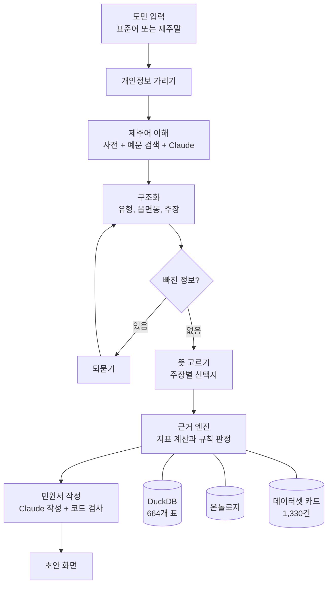
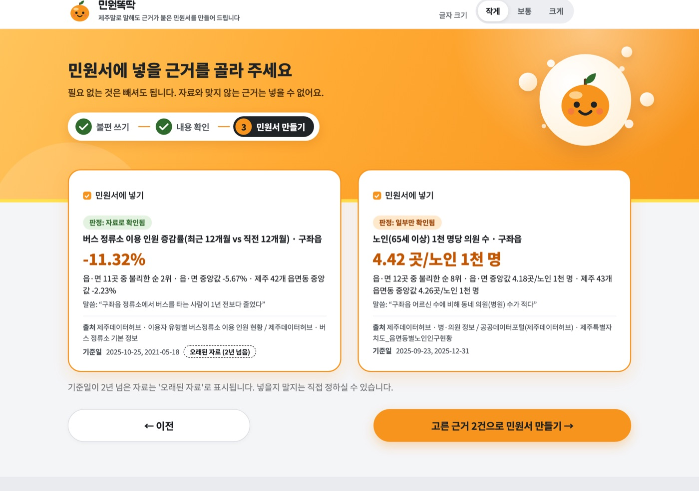
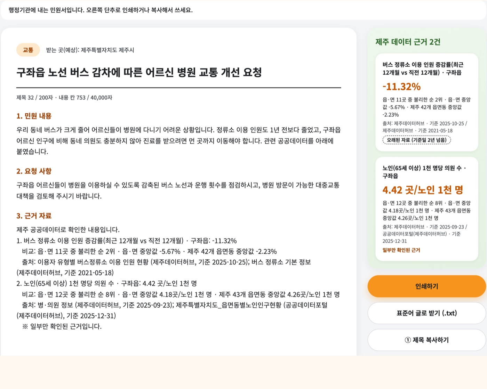
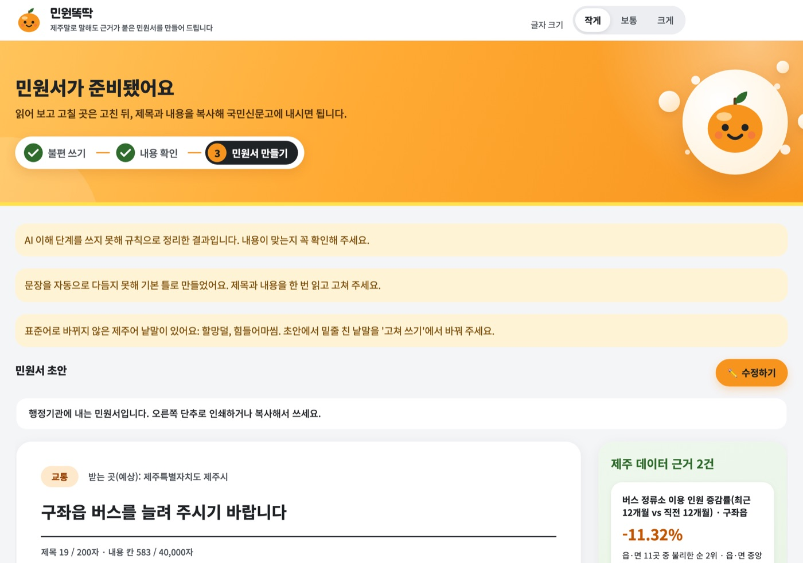

# 민원똑딱 결과 설명자료

제주말로 말한 생활 불편을 제주 공공데이터로 확인하고, 확인된 근거만 담은 표준어 민원서 초안을 만드는 AI Agent

- 출품: 「제주 AI·빅데이터 활용 AI Agent 개발 챌린지」
- 팀: 아꼬비둘
- 기준일: 2026-11-19 (근거 DB 스냅샷 2026-11-17)
- 함께 제출한 문서: [README](README.md), [실행 매뉴얼](실행_매뉴얼.md), [데이터 활용 명세](데이터_활용_명세.md), [아키텍처](docs/architecture.md)

## 목차

1. [요약](#1-요약)
2. [문제 정의](#2-문제-정의)
3. [Agent 구조](#3-agent-구조)
4. [주요 기능](#4-주요-기능)
5. [실행 결과](#5-실행-결과)
6. [검증 방법](#6-검증-방법)
7. [한계와 개선 방향](#7-한계와-개선-방향)
8. [센터 활용 방안](#8-센터-활용-방안)
9. [부록: AI 활용 범위와 외부 서비스](#9-부록-ai-활용-범위와-외부-서비스)

## 1. 요약

| 항목 | 내용 |
| --- | --- |
| 대상 | IT에 익숙하지 않은 제주 도민, 특히 고령층 |
| 입력 | 평소 말투나 제주말로 쓴 불편 한 문장, 선택 사항으로 지역과 주제 |
| 출력 | 국민신문고 칸(제목, 내용)에 맞춘 표준어 민원서 초안과 근거 카드 |
| 근거 | 제주데이터허브 파일 24종(표 29개), Open API 6종, 허브 등록 데이터의 공공데이터포털 원본 18종 |
| 판정 | 등록 지표 17개로 계산하고 같은 유형 지역과 비교해 규칙으로 판정 |
| 사람의 결정 | 되묻기 답, 뜻 고르기, 최종 확인, 넣을 근거 고르기의 4개 지점 |
| 실행 환경 | 센터 PC(i7-8700, RAM 32GB), GPU와 로컬 LLM 미사용, Claude Haiku 5.5 API 사용 |

### 핵심 수치

- 아래 수치는 모두 실제 실행 결과임

- 자체 정답 세트 32건에서 읍면동 인식 32/32, 뜻을 고른 뒤 정답 지표로 근거 계산 35/35
- 제주어 변환 오류 감소율(ERR) 어르신 표본 72.8, 일상대화 표본 45.1 (각 20문장)
- 사전과 예문 검색을 붙인 뒤 문장당 되묻기 수 2.05~2.4개에서 0.5개로 감소 (이전 버전, 같은 20문장)
- 근거 계산 1건 1.3~1.8초 (개발 PC 기준, 프로그램 시작 포함)
- 자동 테스트 523개, Ubuntu와 Windows CI에서 전체 통과

## 2. 문제 정의

### 2.1 배경

제주는 읍면 지역의 고령화가 동 지역보다 뚜렷함. 근거 DB의 행정안전부 주민등록 인구(2026-10-31)로 직접 계산한 결과는 다음과 같음.

| 구분 | 읍면동 수 | 65세 이상 비율 | 범위 |
| --- | --- | --- | --- |
| 제주 전체 | 36곳 | 20.8% (611,965명 중 127,048명) | 12.2% ~ 42.0% |
| 읍면 | 12곳 | 26.9% | 21.8% ~ 42.0% (추자면 최고) |
| 동 | 24곳 | 18.0% | 12.2% ~ 36.0% |

- 서귀포 7개 동은 원자료가 통반 단위라 65세 이상 인구가 없어 계산에서 제외함

### 2.2 어르신이 민원에서 겪는 장벽

| 장벽 | 내용 | 민원똑딱의 대응 |
| --- | --- | --- |
| 표준어 작성 | 국민신문고 같은 창구는 정리된 표준어 글을 요구함 | 제주말 이해, 합니다체 민원서 작성 |
| 근거 요구 | 담당 부서는 불편의 크기를 보여 줄 근거가 있을 때 검토하기 쉬움 | 지역 비교가 담긴 공공데이터 근거 카드 |
| 데이터 접근 | 허브 데이터 1,259종 중 내 동네에 맞는 표를 찾고 계산하기 어려움 | 읍면동 코드로 결합한 지표를 자동 계산 |

### 2.3 분석 주제와 목표

- 분석 주제: 생활 불편 민원의 주장을 제주 공공데이터로 확인하는 근거 생성
- 목표 1: 제주말 문장을 데이터로 확인 가능한 주장으로 나눔
- 목표 2: 주장마다 지표를 계산하고 같은 유형 지역(읍면끼리, 동끼리)과 비교해 판정함
- 목표 3: 확인된 근거만 담은 민원서를 만들고, 확인하지 못한 부분은 그 사실을 밝힘
- 범위 밖: 민원 대리 접수, 처리 결과 예측, 자료가 없는 주제의 수치 추정

## 3. Agent 구조

### 3.1 전체 흐름

- 이해 모듈과 근거 엔진은 JSON 두 개(구조화 질의, 근거 패키지)로만 연결됨
- 두 JSON은 `evidence_engine/contracts/`의 JSON Schema로 입력과 출력 모두 검사함

### 3.2 역할과 도구

| 역할 | 목표 | 사용 도구 | 판단 주체 |
| --- | --- | --- | --- |
| 이해 | 제주말을 표준어로 바꾸고 뜻이 불확실한 낱말 선별 | 방언 사전 59,473 낱말, TF-IDF 예문 검색, Claude | Claude가 바꾸고 코드가 사전 근거를 검사 |
| 구조화 | 민원 유형, 읍면동, 주장, 바라는 점 추출 | Claude 구조화 출력, 43개 읍면동 목록, JSON Schema | Claude가 채우고 코드가 목록과 스키마로 검사 |
| 되묻기 | 빠지거나 불확실한 항목만 질문 | 상태 검사 규칙 | 규칙 |
| 뜻 고르기 | 주장마다 계산 가능한 뜻과 자료 없는 뜻 제시 | 지표 등록부(판정 17개, 맥락 3개) | 사용자 |
| 근거 찾기 | 개념 확장, 데이터 검색, 지표 계산, 지역 비교, 판정 | 온톨로지(트리플 6,115개), BM25 카드 검색, DuckDB 읽기 전용 SQL | 규칙 |
| 작성 | 제목, 민원 내용, 요청 사항을 합니다체로 작성 | Claude, 숫자와 길이 검사, 개인정보 재검사 | Claude가 쓰고 코드가 통과 여부 결정 |

### 3.3 판단과 자율 수행 범위

| 구분 | Agent가 스스로 수행 | 사람이 결정 |
| --- | --- | --- |
| 이해 | 제주말 변환, 주장 분리, 유형 분류 | 뜻이 불확실한 낱말의 뜻 (되묻기 답) |
| 근거 | 데이터 검색, 지표 계산, 지역 비교, 판정, 주의 사항 표시 | 주장의 뜻 (뜻 고르기), 이해 내용 승인 (최종 확인) |
| 작성 | 민원서 문장 작성과 검사 | 민원서에 넣을 근거 선택, 문장 수정, 접수 여부 |

- 숫자는 도구만 만듦: 근거 값은 등록 지표 함수와 읽기 전용 SQL 결과만 사용함
- LLM은 숫자를 받지 않음: 민원서 작성 때 근거 이름만 넘기고, 결과에 사용자 글에 없던 숫자가 있으면 기본 문장 틀로 대체함
- 판정은 규칙이 내림: "자료로 확인됨, 일부만 확인됨, 자료와 다름, 자료로 확인 불가" 4단계
- 사용자가 확인하지 않은 내용은 초안에 넣지 않음. 접수는 사용자가 직접 함

### 3.4 근거 엔진

- 두 경로를 합쳐 데이터를 찾음
  - 온톨로지: 주장 낱말을 개념으로 바꾸고 관계를 3단계까지 따라가 데이터 후보를 찾음
  - 카탈로그 검색: 데이터셋 카드 1,330건을 BM25로 검색하고 개념 태그, 공간, 최신성으로 순위를 매김
  - 순위 점수: 경로 0.4, 검색 0.3, 공간 일치 0.2, 최신성 0.1의 가중합
- 판정 기준

| 지표 종류 | 자료로 확인됨 | 자료와 다름 | 그 사이 |
| --- | --- | --- | --- |
| 순위형 | 비교 지역의 66.7% 이상이 이 지역보다 나음 | 33.3% 이하만 이 지역보다 나음 | 일부만 확인됨 |
| 증감형 (감소 주장) | 증감률 -5% 이하 | +2% 이상 | 일부만 확인됨 |

- 판정 하향: 주장과 다른 측면을 재는 대리 지표, 공개 목록이 일부만 담은 약한 자료는 "일부만 확인됨"으로 낮춤
- 주의 표시: 결측 30% 초과, 기준일 2년 초과 자료에 주의 사항을 붙임
- 안전 장치: SQL은 읽기 전용, 결과 최대 1,000행, 대기 최대 10초

## 4. 주요 기능

### 4.1 화면 흐름

| 단계 | 화면 | 핵심 동작 |
| --- | --- | --- |
| 1. 불편 쓰기 | 글 칸, 지역(최대 3곳), 주제(7개, 건너뛰기 가능) | 평소 말투와 제주말 입력 |
| 2. 내용 확인 | 되묻기 → 뜻 고르기(주장마다 최대 3개) → 최종 확인 | 사람이 뜻과 이해 내용을 확정 |
| 3. 민원서 만들기 | 근거 카드 선택 → 초안 | 판정, 값, 지역 비교, 출처, 기준일 확인 후 선택 |

그림 1. 불편 쓰기 화면. 제주말 그대로 입력하고 지역과 주제는 선택 사항임

### 4.2 기능 목록

| 기능 | 내용 |
| --- | --- |
| 제주말 이해 | 방언 사전과 예문 검색 결과를 근거로 Claude가 표준어로 변환. 사전 근거 없이 바꾼 낱말만 되물음 |
| 지역 인식 | 문장 속 읍면동 이름, 리 이름(법정동 연계정보)으로 행정동 코드 연결. 못 찾으면 목록에서 선택 |
| 뜻 고르기 | 한 주장의 여러 해석(운행 횟수, 이용 인원, 정류소 수 등)을 선택지로 제시. 자료 없는 뜻은 "확인할 자료 없음"으로 표시 |
| 근거 카드 | 판정, 값, 같은 유형 지역 안 순위와 중앙값, 출처, 기준일, 오래된 자료 표시 |
| 민원서 작성 | 국민신문고 칸에 맞춘 제목과 내용, 처리기관(제주시, 서귀포시) 참고 안내, 글자 수 표시 |
| 수정과 출력 | 제목, 내용, 요청 사항 수정. 근거 칸은 잠금. 복사, 인쇄, 텍스트 파일 받기 |
| 어르신 편의 | 글자 크기 3단계(15, 17, 20px), 최소 높이 60px 단추, 한 화면 한 질문 |
| 개인정보 보호 | 이름, 전화번호, 주민번호, 이메일, 상세주소를 Claude 호출 전 `○○`로 가림. 엔진은 원문을 받자마자 버림 |
| 실패 대응 | Claude 실패 시 규칙 구조화와 기본 문장 틀, DB 없음 시 형식 확인 모드와 복사 차단. 어떤 경우든 화면에 사유 안내 |
| 요금 보호 | `ALLOW_PAID_CALLS=1`을 사람이 직접 설정할 때만 Claude 호출 |

## 5. 실행 결과

### 5.1 시나리오 1: 제주말 민원 (Claude 사용)

- 입력: "우리 동네 버스가 확 줄어부난 할망덜 병원 가기가 막 힘들어마씸", 지역 구좌읍
- 실행: 2026-11-19, 근거 DB 스냅샷 2026-11-17, Claude Haiku 5.5

이해 결과:

- 제주말 문장을 주장 2개로 분리함: "버스가 줄었다", "노인의 병원 접근이 어렵다"
- 주장마다 뜻 선택지 5개와 기타를 제시함. 확인할 자료가 없는 뜻("버스 운행 횟수나 배차가 줄었다", "밤이나 주말에 진료하는 병원이 없다")에는 "확인할 자료 없음"을 붙임

그림 2. 뜻 고르기. 한 문장에서 나온 두 주장마다 데이터로 확인할 수 있는 뜻을 고름

그림 3. 최종 확인. 지역, 유형, 고른 문제를 보여 주고 사용자가 승인함

근거 결과:

| 주장 | 지표 | 값 | 같은 유형 지역 비교 | 판정 |
| --- | --- | --- | --- | --- |
| 정류소 이용 인원 감소 | 버스 정류소 이용 인원 증감률 (최근 12개월 대 직전 12개월) | -11.32% | 읍면 11곳 중 불리한 순 2위, 읍면 중앙값 -5.67% | 자료로 확인됨 |
| 어르신 대비 의원 부족 | 65세 이상 1천 명당 의원 수 | 4.42곳 | 읍면 12곳 중 불리한 순 8위, 읍면 중앙값 4.18곳 | 일부만 확인됨 |

- 정류소 기본 정보의 기준일이 2021-05-18이라 "오래된 자료 (2년 넘음)" 표시가 붙음
- 의원 수는 읍면 중앙값보다 많아 주장을 완전히 뒷받침하지 않음. "일부만 확인됨"으로 표시하고 민원서에도 그대로 밝힘

그림 4. 근거 고르기. 판정, 값, 지역 비교, 출처, 기준일을 카드로 보여 줌

민원서 결과:

- 제목: "구좌읍 노선 버스 감차에 따른 어르신 병원 교통 개선 요청" (32자)
- 내용 칸 753자, 근거 자료 칸에는 엔진의 값과 출처를 그대로 옮김

그림 5. Claude가 작성한 민원서 초안과 오른쪽 근거 요약

### 5.2 시나리오 2: 자료가 없는 민원

- 입력: "노형 사는데 밤길이 너무 어두워요 가로등 좀 달아 주세요" (지역 선택 없음)
- 되묻기: 문장의 "노형"을 "노형동"으로 연결하고 확인 질문을 함
- 뜻 고르기: "밤길을 밝힐 가로등, 보안등이 부족하다"에 "확인할 자료 없음" 표시
- 근거: 가로등과 보안등 데이터가 허브에 없어 "자료로 뒷받침되는 근거를 찾지 못했어요"로 안내하고, 숫자 없이 민원서를 만듦

그림 6. 되묻기. 불확실한 지역 이름만 한 번 확인함

그림 7. 확인할 자료가 없으면 수치를 만들지 않고 그 사실을 알림

### 5.3 시나리오 3: Claude를 쓸 수 없을 때

- 같은 구좌읍 문장을 `ALLOW_PAID_CALLS=0`(유료 호출 차단)으로 실행함
- 규칙 구조화로 주장을 문장 하나로 묶고, 사용자가 뜻을 골라 같은 근거 2건(-11.32%, 4.42곳)을 계산함
- 민원서는 기본 문장 틀로 작성하고, 표준어로 바뀌지 않은 "할망덜", "힘들어마씸"에 밑줄과 경고를 표시함
- 화면 위에 "AI 이해 단계를 쓰지 못해 규칙으로 정리한 결과" 안내가 나옴

그림 8. Claude 없이도 근거 계산과 민원서 작성까지 끝나고, 어떤 경로로 만들었는지 안내함

## 6. 검증 방법

### 6.1 검증 항목

| 항목 | 방법 | 결과 |
| --- | --- | --- |
| 자동 테스트 | pytest 523개, 네트워크와 유료 호출 없이 실행 | 전부 통과 |
| CI | GitHub Actions, Ubuntu와 Windows에서 전체 설치와 일부가 빠진 설치, CP949 출력, `설치.bat` 실제 실행 | 통과 (main 기준) |
| 이해와 근거 | 자체 정답 세트 32건 (`complaint_agent/eval/gold.yaml`), 규칙 구조화 기준 | 아래 표 |
| 제주어 변환 | AI Hub 평가셋 일상대화, 어르신 각 20문장 표본, 어절 단위 지표 | 아래 표 |
| 재현성 | 근거 DB 전체를 parquet 스냅샷(664개 파일, 약 63MB)으로 고정, 설치 때 해시와 행 수 대조 | 같은 입력에 같은 값 |
| 데이터 명세 | `data_spec.py`가 근거 DB와 지표 등록부에서 명세를 자동 생성, 오픈소스 버전은 `requirements.txt`와 테스트로 대조 | 불일치 시 테스트 실패 |

### 6.2 정답 세트 평가 (2026-11-19, 유료 호출 없음)

- 구성: 표준어 24건, 제주말 3건, 지역 없음 2건, 짧은 지명 2건, 여러 지역 1건
- 등록 빈칸 주제 민원 4건 포함 (무더위쉼터, 가로등, 버스 배차, 주말 진료)
- 근거 엔진에 지표가 없는 민원 4건 포함 (치매안심센터, 공영주차장, 물가, 놀이터)

| 지표 | 결과 |
| --- | --- |
| 읍면동 인식 (없으면 목록 제시) | 32/32 |
| 주제 인식 | 32/32 |
| 정답 뜻이 선택지에 포함 | 31/31 |
| 추천 1순위가 정답 | 30/32 (94%) |
| 자료 없는 민원에 선택지를 내지 않음 | 4/4 |
| 뜻을 고른 뒤 정답 지표로 근거 계산 | 35/35 |
| 뜻을 고르지 않고 엔진에 맡김 | 30/35 (86%) |
| 값이 계산된 근거 | 28/36 (78%) |
| 판정 분포 | 자료로 확인됨 7, 일부만 확인됨 13, 자료와 다름 7, 자료로 확인 불가 9 |
| 오래된 자료 주의가 붙은 근거 | 14건 |

- 뜻을 고르지 않으면 정답 지표 비율이 100%에서 86%로 떨어짐. 뜻 고르기 단계를 둔 근거임
- 값이 없는 근거 8건의 구성: 등록 빈칸 주제 4건, 허브에 맞는 자료가 없는 주제 3건(공영주차장, 물가, 놀이터), 지역 없이 쓴 민원 1건
- 치매안심센터 민원은 미리 받은 시설 목록으로 "참고용 자동 집계" 값을 계산함

### 6.3 제주어 변환 평가 (Claude Haiku 5.5, 사전과 예문 검색 사용)

| 평가셋 | ERR | 재현율 | 과잉 수정률(FPR) | CER | BLEU | 문장당 되묻기 |
| --- | --- | --- | --- | --- | --- | --- |
| 일상대화 20문장 | 45.1 | 54.9 | 4.5 | 12.2 | 71.5 | 0.45 |
| 어르신 20문장 | 72.8 | 77.2 | 2.3 | 7.9 | 77.4 | 0.30 |

- 지표 정의는 어휘 정규화 선행 연구(van der Goot 2019, MultiLexNorm 2021)를 따름. ERR은 바꿔야 할 어절 대비 맞게 바꾼 수에서 잘못 바꾼 수를 뺀 비율
- 사전과 예문 검색의 효과 (이전 버전 예측, 같은 20문장 비교)

| 평가셋 | 방법 | ERR | 과잉 수정률 | 문장당 되묻기 |
| --- | --- | --- | --- | --- |
| 일상대화 | LLM만 | 11.8 | 12.5 | 2.05 |
| 일상대화 | 사전 + 예문 + LLM | 39.2 | 5.4 | 0.5 |
| 어르신 | LLM만 | 43.5 | 2.3 | 2.4 |
| 어르신 | 사전 + 예문 + LLM | 75.0 | 2.3 | 0.5 |

- 같은 모델에서 사전과 예문을 근거로 준 것만으로 ERR이 27~32점 오르고 되묻기가 4분의 1 수준으로 줄어듦
- 전처리에서 AI Hub 원자료의 비식별화 오류를 고쳐 평가 제외 비율을 25%에서 1.3%로 낮춤

## 7. 한계와 개선 방향

| 한계 | 측정 결과 | 영향 | 개선 방향 |
| --- | --- | --- | --- |
| 데이터 범위 | 허브 1,259종 중 559종(44%) 수집. 미리 받은 602개 표 중 읍면동 키가 있는 표 231개, 시설 목록 158개(대부분 무장애 산책로 지점) | 가로등과 보안등, 무더위쉼터, 버스 배차, 주민센터는 허브에 데이터가 없어 확인 불가 | 데이터 1종당 약 30~60분 추가 절차 문서화 (수집 → 적재 → 지표 등록 → 평가 → 스냅샷) |
| 오래된 자료 | 핵심 표 56개 중 27개가 기준일 2년 초과 | 근거 카드에 "오래된 자료" 표시, 판정에는 사용 | 센터 정기 갱신 시 스냅샷 재생성 |
| 대리 지표 | 버스 운행 횟수 대신 정류소 이용 인원 사용 | 주장과 측면이 다르면 "일부만 확인됨"으로 하향 | 운행 실적 데이터 개방 시 지표 교체 |
| 정답 세트 | 32건 모두 팀이 직접 작성, 사람 검수 전. 판정 정확도는 아직 측정하지 않음 | 수치는 이해와 지표 선택 정확도로 한정해 해석 | 센터 실제 민원으로 정답 세트 확대, 판정을 원자료로 검증 |
| 제주어 평가 표본 | 평가셋별 20문장 | 오차 범위가 큼 | 전체 평가셋 실행 (유료 호출 비용 승인 후) |
| 민원 어휘 | 사전이 일상대화 자료 기반이라 배수로, 가로등 같은 민원 어휘가 적음 | 민원 고유 어휘의 변환 누락 가능 | 교정 기록으로 민원 어휘 보강 (8.3 참고) |
| 문장 표현 | 숫자는 코드가 검사하지만 표현은 검사하지 않음. 시나리오 1 초안에 "감축된 버스 노선과 운행 횟수" 같은, 데이터가 직접 보여 주지 않는 표현이 들어감 | 근거보다 강한 표현 가능. 근거 칸의 값과 출처는 잠겨 있어 수치 왜곡은 없음 | 판정과 맞지 않는 단정 표현 검사 규칙 추가 |
| 규칙 모드 | Claude 없이 실행하면 주장을 문장 하나로 묶고 제주말이 남음 | 뜻 고르기 의존도 증가, 표준어 수정 필요 | 화면 안내와 밑줄 표시로 보완 중 |

## 8. 센터 활용 방안

### 8.1 민원 작성 지원 창구

- 운영 형태: 센터 PC에서 `실행.bat`으로 실행, 브라우저는 실행한 PC에서만 열림
- 이용 방식: 방문 도민이 직접 쓰거나 상담 인력이 옆에서 함께 입력
- 운영 비용: 민원 1건당 Claude Haiku 3~4회 호출. 키가 없거나 꺼져도 규칙 모드로 동작
- 운영 부담: 설치 1회(`설치.bat`), GPU와 로컬 LLM 불필요, 인터넷은 Claude 사용 시에만 필요

### 8.2 데이터 갱신과 확장

| 작업 | 절차 | 소요 |
| --- | --- | --- |
| 기존 데이터 갱신 | 수집 → `build_db.py` 적재 → 정답 세트 평가 → 스냅샷 → 데이터 명세 재생성 | 데이터 양에 비례 |
| 새 데이터 추가 | `datasets.yaml` 등록 → 적재 → 지표 등록부(`registry.yaml`)에 계산식과 뜻 선택지 추가 → 평가 | 데이터 1종당 약 30~60분 |
| 새 주제 추가 | 지표 등록부의 `topics`에 주제를 추가하고 지표와 뜻 선택지 등록 | 지표 수에 비례 |

- 데이터 수집에 필요한 허브 프로젝트 키와 공공데이터포털 인증키 발급 방법은 실행 매뉴얼 10번에 정리함

### 8.3 운영 개선 루프 (제안)

- 교정 신호: 추천이 아닌 뜻 선택, "기타" 선택, 최종 확인의 "아니요"
- 절차: 교정 신호 기록(가린 핵심 낱말만, 문장 저장 없음) → 후보 집계 → 운영자 검토 → 지표 등록부와 사전 반영 → 정답 세트 재평가 → 변경 기록 보관
- 자동 학습을 쓰지 않는 이유: 한 사용자의 입력이 규칙을 오염시킬 위험, 결과 재현성 저하, 개인정보 저장 위험
- 현재 상태: 뜻 고르기와 최종 확인 화면은 구현됨. 교정 기록과 후보 집계 스크립트, 관리자 승인 화면은 추가 개발 필요

### 8.4 데이터 개방 수요 파악 (제안)

- "자료로 확인 불가" 판정마다 근거 패키지의 빈칸(`gaps`)에 개념과 사유가 남음
- 이 빈칸을 주제별로 모으면 도민이 실제로 근거를 원했지만 데이터가 없는 분야가 드러남
- 현재 등록된 빈칸 주제: 가로등과 보안등, 무더위쉼터, 버스 운행 횟수와 배차 간격, 야간과 휴일 진료
- 빈칸 집계 화면은 추가 개발 필요

## 9. 부록: AI 활용 범위와 외부 서비스

### 9.1 사용 모델

| 모델 | 사용 위치 | 프롬프트 위치 | 실패 시 |
| --- | --- | --- | --- |
| Claude Haiku 5.5 (`claude-haiku-5-5`) | 제주어 표준어 변환 | `dialect_normalizer/normalize.py` (`RULES_RAG`) | 표준어 변환 없이 진행 |
| 같은 모델 | 구조화 (유형, 읍면동, 주장) | `dialect_normalizer/structure.py` (`RULES`) | 규칙 구조화 |
| 같은 모델 | 민원서 제목, 내용, 요청 사항 작성 | `complaint_draft/writer.py` (`SYSTEM`) | 기본 문장 틀 |

- 모든 호출은 `dialect_normalizer/llm.py` 한 곳을 지나감. 응답 대기 최대 60초, 재시도 1회
- 근거 엔진의 LLM 기능(교차 확인 선택, SQL 초안)은 제출본에서 꺼 둠. 숫자와 판정은 LLM을 쓰지 않음

### 9.2 개발 과정의 AI 활용

- Claude Code(Anthropic): 코드 작성과 검토
- Claude Haiku 5.5: 제주어 변환 평가 실행
- 온톨로지와 개념 태그는 LLM 없이 규칙으로 생성함

### 9.3 외부 서비스와 데이터

| 서비스 | 용도 | 필요 시점 |
| --- | --- | --- |
| Claude API (Anthropic) | 제주어 이해, 구조화, 민원서 작성 | 실행 중 (없으면 규칙 모드) |
| 제주데이터허브 Open API | 데이터 수집 | 데이터 갱신 시에만 |
| 공공데이터포털 Open API | 인구 자료 수집 | 데이터 갱신 시에만 |
| Google Fonts | 화면 글꼴 (Jua, Noto Sans KR) | 실행 중 (없으면 기본 글꼴) |

- 데이터별 출처, 기준일, 이용조건, 오픈소스 목록과 라이선스는 [데이터 활용 명세](데이터_활용_명세.md)에 정리함
- 제출 ZIP에는 평가 전용 Claude 키만 포함함. 데이터 API 키는 포함하지 않음
